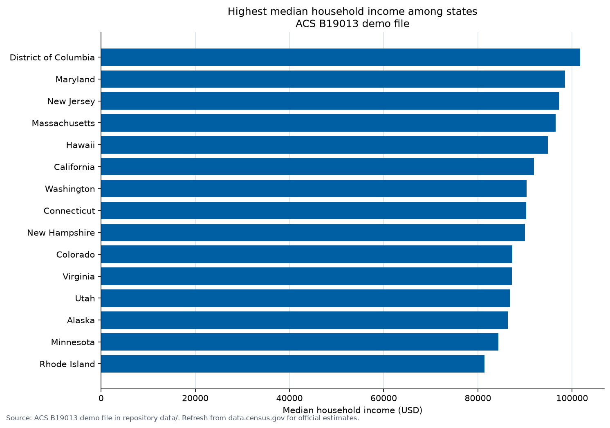

# Bar Chart 

Also known as: bar graph, column chart, vertical bar chart, horizontal bar chart.

A bar chart displays categorical data with rectangular bars whose length or height corresponds to the value of each data point.

Bar charts can be visualized using vertical or horizontal bars. Bar charts are best used to compare a single category of data or several. When comparing more than one category of data, the bars can be grouped together to create a grouped bar chart.

## Best Practices

In addition to the guidance provided in this section, relevant guidance can also be found in the Agency Logo, Axes, Colors, Grids, Legends, Source, Titles, Typography sections.

### Essential

* Bars must always start at the zero origin.  The heights or lengths of the bars are proportional to the values they represent. For this reason, bar charts that do not start at zero will mislead the viewer's assessment of the differences between the values.
* The author should facilitate the most important analytic comparison by placing the bars representing the relevant quantities next to each other or in groupings.
* If any categories have been removed from the chart which would normally be displayed, then a statement of omission or exclusion is needed.
* Authors must use labels which read from left to right.  If the category labels are too long along the x-axis, then make the bars horizontal along the y-axis to improve label readability.
* Use the same width for each bar.

### Avoid

* Never omit the space between categories   otherwise the bar chart will appear to be a histogram.
* Never use three-dimensional (3D) graphics as they distort the image and interpretation.

## Recommendations

* Visual components of the bar chart should be utilized with purpose to promote: 
  * readability,
  * ease of interpretation,
  * transparency,
  * reduction of redundancy.
  
The visual components that should be balanced in usage include: axis labels, data labels, tick marks, color, legend, boldness, spacing etc.

* Bar charts, including stacked bar charts, should have labels sufficient to clearly define the categories represented.
* Author shall sort bars in an analytic sense which helps understanding the main purpose of the chart.  If there is no natural analytic ordering (ex: ordinal variable), then sort the bars by size in descending order.
* Use consistent scales when creating small multiple charts. Ensure the bar thickness is more than the white space between the bars.
* Only use additional color to highlight the key purpose of the chart.
* Use only one color for all bars unless there is a need to emphasize a single bar compared to the others.
* Limit the number of bars, if possible. Using many bars makes it difficult for the eye to discern each individual bar.
* Use Horizontal bar charts unless the labeling of data needs more space. 

## Examples

Page 24-28 figures 7-13

## Developer implementation

This repository includes a reproducible horizontal bar-chart recipe using a public ACS-style demo file.

### Requirements

- Python: `pandas`, `matplotlib`
- R: `readr`, `dplyr`, `ggplot2`
- Data file: [`data/median_household_income_by_state.csv`](../data/median_household_income_by_state.csv)

### Python

```bash
pip install pandas matplotlib
python scripts/python/bar_chart_median_income.py
```

Script: [`scripts/python/bar_chart_median_income.py`](../scripts/python/bar_chart_median_income.py)

### R

```r
install.packages(c("readr", "dplyr", "ggplot2"))
source("scripts/r/bar_chart_median_income.R")
```

Script: [`scripts/r/bar_chart_median_income.R`](../scripts/r/bar_chart_median_income.R)

### Example output



### Output and accessibility notes

- Charts are written to `assets/examples/`.
- When publishing, include alt text that states the chart type, metric, geography, and main finding.
- Provide the CSV (or an HTML table) as an accessible fallback.
- Refresh values from [data.census.gov](https://data.census.gov/) table **B19013** before using the figure in an official product.

<div class="code-block-note" role="note">
  The demo CSV is an illustrative teaching file for capstone workflows. Official releases must use current public Census estimates and full source citations.
</div>

